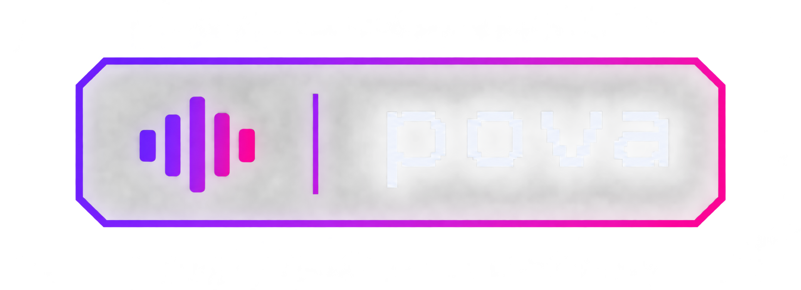
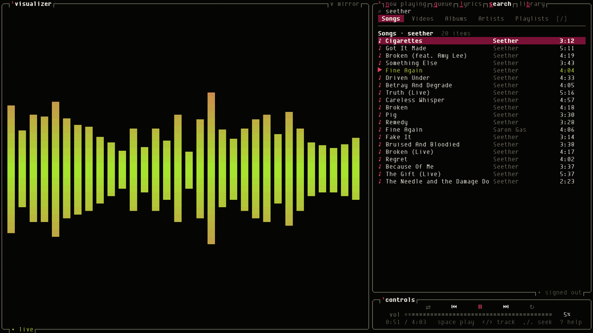
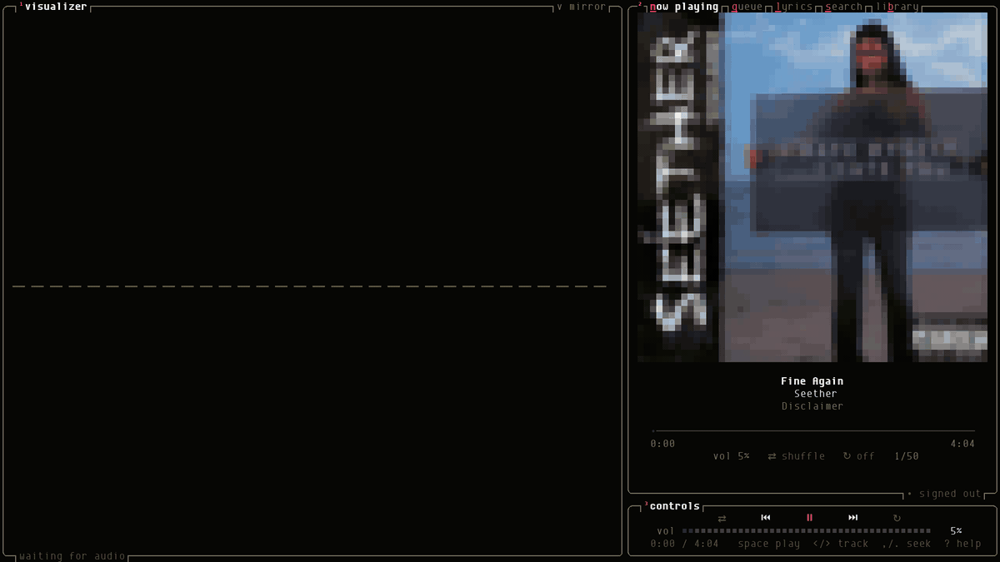

<p align="center">
  
</p>

<p align="center">
  <b>YouTube Music, a cava visualizer, and btop's sense of style, in one terminal window.</b><br>
  Written in Rust. Built for people who would rather <code>alt-tab</code> to a terminal than to a browser tab.
</p>

<p align="center">
  <a href="https://github.com/ratatui/awesome-ratatui#music-and-audio"></a>
</p>

<p align="center">
  <a href="https://github.com/P0r0ro/pova/releases/latest"></a>
  <a href="https://crates.io/crates/pova"></a>
  <a href="https://crates.io/crates/pova"></a>
  <a href="https://copr.fedorainfracloud.org/coprs/p0r0ro/pova/"></a>
  <a href="https://github.com/P0r0ro/pova/actions/workflows/ci.yml"></a>
  <a href="LICENSE"></a>
  <a href="https://ratatui.rs/"></a>
</p>

---

## So what is this

You like your music. You like your terminal. You like watching bars jump.
Until now that meant three programs: a browser tab with YouTube Music in it,
`cava` in one pane, and some regret.

**pova** is all of that in one place. It looks like btop, it plays YouTube
Music, and its visualizer is a real port of cava that listens to *pova's own
audio* and nothing else. Your Discord notification sounds are not music, and
pova knows that.

<p align="center">
  <a href="assets/pova-launch.mp4">
    
  </a><br>
  <sub><a href="assets/pova-launch.mp4">Watch it with sound (MP4)</a> · music: Sascha Ende, ende.app (CC BY 4.0)</sub>
</p>

<p align="center">
  
</p>

## Install

pova runs on Linux with PipeWire. It was built on Fedora KDE with kitty, and
kitty shows real album art (other terminals get a blocky version).

| Method | Best for | Installs mpv, yt-dlp and the PipeWire tools for you |
|---|---|---|
| [Fedora COPR](#fedora-copr) | Fedora: one command, updates with your system | yes |
| [apt repository](#debian-and-ubuntu-apt) | Debian, Ubuntu, Linux Mint, Pop!_OS: updates with your system | yes |
| [`.rpm` package](#fedora-rpm) | Fedora and other dnf-based distros, without adding a repository | yes |
| [`.deb` package](#debian-and-ubuntu-deb) | apt-based distros, without adding a repository | yes |
| [AppImage](#appimage) | any distro, nothing to install | no |
| [Prebuilt binary](#prebuilt-binary) | any distro, a single file in your `PATH` | no |
| [crates.io](#from-cratesio-or-source) | Rust users, other CPU architectures | no |

Every file is on the [latest release](https://github.com/P0r0ro/pova/releases/latest)
page, with a `.sha256` checksum next to it. The commands below use version 1.2.1.

**Coming soon:** the Arch AUR package (`yay -S pova-bin`). It's built and
tested, and waits on an account.

### Fedora (COPR)

The easiest way on Fedora: add pova's [COPR repository](https://copr.fedorainfracloud.org/coprs/p0r0ro/pova/)
once, and from then on pova updates along with the rest of your system. `dnf`
pulls in mpv, yt-dlp and pipewire-utils, and pova shows up in your app menu.

```sh
sudo dnf copr enable p0r0ro/pova
sudo dnf install pova
```

Built for Fedora 43, 44, 45 and rawhide.

### Debian and Ubuntu (apt)

Add pova's apt repository once, and from then on pova updates with
`sudo apt upgrade` like everything else. `apt` pulls in mpv, yt-dlp and
pipewire-bin, and pova shows up in your app menu. Works on Debian, Ubuntu,
Linux Mint, Pop!_OS and other apt-based distros.

```sh
sudo install -d -m 0755 /etc/apt/keyrings
curl -fsSL https://p0r0ro.github.io/pova/apt/pova.gpg | sudo tee /etc/apt/keyrings/pova.gpg > /dev/null
echo "deb [signed-by=/etc/apt/keyrings/pova.gpg] https://p0r0ro.github.io/pova/apt stable main" | sudo tee /etc/apt/sources.list.d/pova.list
sudo apt update && sudo apt install pova
```

The repository holds the same `.deb` as the release page, signed with pova's
own key.

### Fedora (.rpm)

`dnf` installs pova and pulls in mpv, yt-dlp and pipewire-utils from Fedora's
own repositories. pova also shows up in your app menu.

```sh
sudo dnf install https://github.com/P0r0ro/pova/releases/download/v1.2.1/pova-1.2.1-1.x86_64.rpm
```

### Debian and Ubuntu (.deb)

`apt` installs pova and pulls in mpv, yt-dlp and pipewire-bin. pova also shows
up in your app menu.

```sh
curl -LO https://github.com/P0r0ro/pova/releases/download/v1.2.1/pova_1.2.1-1_amd64.deb
sudo apt install ./pova_1.2.1-1_amd64.deb
```

On older releases such as Ubuntu 22.04, the distro's yt-dlp is often too old
for YouTube. If songs won't start, get a current one with `pipx install yt-dlp`.

### AppImage

One file that runs on any distro. You install pova's helpers yourself
([see below](#the-helpers-pova-needs)).

```sh
curl -LO https://github.com/P0r0ro/pova/releases/download/v1.2.1/pova-v1.2.1-x86_64.AppImage
chmod +x pova-v1.2.1-x86_64.AppImage
./pova-v1.2.1-x86_64.AppImage
```

### Prebuilt binary

A plain binary plus the sign-in helper. You install pova's helpers yourself
([see below](#the-helpers-pova-needs)).

```sh
curl -LO https://github.com/P0r0ro/pova/releases/download/v1.2.1/pova-v1.2.1-x86_64-linux.tar.gz
tar xzf pova-v1.2.1-x86_64-linux.tar.gz
install -Dm755 pova-v1.2.1-x86_64-linux/pova ~/.local/bin/pova
```

### From crates.io or source

Needs a Rust toolchain from <https://rustup.rs>. pova is
[on crates.io](https://crates.io/crates/pova):

```sh
cargo install pova
```

Or build straight from GitHub:

```sh
cargo install --git https://github.com/P0r0ro/pova --tag v1.2.1
```

### The helpers pova needs

The `.rpm` and `.deb` install these for you. For the other methods:

```sh
sudo dnf install mpv yt-dlp pipewire-utils nodejs        # Fedora
sudo apt install mpv yt-dlp pipewire-bin nodejs          # Debian, Ubuntu
sudo pacman -S mpv yt-dlp pipewire-audio nodejs          # Arch
```

| Program | What pova uses it for |
|---|---|
| `mpv` | playing the audio, with no window |
| `yt-dlp` | turning a YouTube Music link into an audio stream |
| `nodejs` or `deno` | lets yt-dlp solve YouTube's JavaScript challenge |
| `pw-record`, `pw-dump` (PipeWire tools) | capturing pova's audio for the visualizer |
| `btop` (optional) | about 40 extra themes |
| `mpv-mpris` (optional) | media keys and your desktop's media widget |

### Play something

```sh
pova                                   # then press / and search
pova --play "seether fine again"       # or straight from the shell
```

## What you can do

### Search from your terminal

Press `/`, start typing, and suggestions drop down under the box. Spelling
is optional: type `call me when your sober` and pova still finds Evanescence,
the same way YouTube Music's own "did you mean" would. `tab` switches between
Songs, Videos, Albums, Artists and Playlists; `enter` plays.

<p align="center"></p>

### Queue things up

`A` plays the selected song next, `a` adds it to the end. In the queue (`q`),
`J` and `K` move songs up and down, `d` removes them. When the queue runs out,
autoplay keeps going with a radio of similar songs, like the website does.

<p align="center"></p>

### Move between songs

`N` and `P` skip forward and back, `←` `→` seek 5 seconds, `H` `L` seek 30.
pova looks up the next songs while the current one plays, so skipping is
near-instant, and the next track is preloaded so albums play gaplessly.

<p align="center"></p>

### Live lyrics

Press `l`. Time-synced lyrics from LRCLIB scroll and highlight as the song
plays. If LRCLIB has nothing, pova asks YouTube Music. If *nobody* has
lyrics, you get the cat. (See below. Be nice to the cat.)

<p align="center"></p>

### Like songs

Press `f` to like or unlike what's playing. Songs you've already liked show a
♥ everywhere: in Now Playing, the queue and search results. `F` dislikes the
song and skips it, which also steers your radio and autoplay away from it.
This needs you to sign in once (next section).

<p align="center"></p>

### And also

- **Four visualizer modes** (`v`): stereo bars, mirror, mono and a waveform.
- **Every btop theme** (`t`): pova reads btop's `.theme` files as they are, with a live preview. The four Catppuccin flavours are built in.
- **The Esc menu**: btop-style, with the pova logo drawn in block characters, for themes, the visualizer, autoplay and album art.
- **Your library** (`b`): your playlists, liked songs and history once you're signed in.
- **Your playlists** (`p`): add the song you're on to one of your playlists or a new one, take songs out with `d`, and delete a playlist with `D` (it asks first).
- **Even loudness**: every song plays at about the same volume, so a quiet acoustic track doesn't follow a loud one at half the level. On by default; switch it in the `esc` menu.
- **Song-change notifications**: a desktop popup with the cover art when the song changes. Off by default; turn it on in the `esc` menu.
- **Up next**: Now Playing shows which song comes after this one.
- **Picks up where you left off**: quit and come back to the same queue, paused at the same second.
- **Control it from anywhere**: `pova next`, `pova add <song>`, `pova status` and more, for keyboard shortcuts and status bars. See [docs/remote-control.md](docs/remote-control.md).
- **Mouse support**: click tabs, buttons, list rows, the progress bar and the volume bar, and scroll anywhere.

Press `?` in pova for every key, or read [docs/keys.md](docs/keys.md).

## Signing in

Search, playback, radio and lyrics work without an account. To like songs and
see your library, let pova borrow the YouTube Music login your browser already
has. If you're signed in to <https://music.youtube.com>:

```sh
pova-import-cookie chrome              # installed with the .deb / .rpm
./scripts/import-cookie.sh chrome      # from a source checkout
# works with firefox, chromium, brave, edge, vivaldi, opera too
```

A couple of seconds later the player box says **● signed in**, no restart
needed. If Google ever expires the cookie, pova tells you; run the script again.
The cookie is saved in
`~/.config/pova/cookie.txt`, readable only by you. Treat it like a password.
No script? [docs/signing-in.md](docs/signing-in.md) has the manual way.

## Meet the cat

<p align="center">
  
</p>

This is pova's mascot. It lives in the Lyrics tab and appears only when a
song has no lyrics anywhere: not on LRCLIB, not on YouTube Music, nowhere. It's
not angry. It's just disappointed. Mostly it shows up for instrumentals,
obscure uploads and "Me at the zoo".

## If you like pova

<p align="center">
  <a href="https://github.com/P0r0ro/pova"></a>
</p>

<p align="center">
  pova is a one-person project, and a star is how other people find it.<br>
  If it earned a spot in your terminal, starring the repo helps more than you'd think<br>
  and means a lot to the person who built it. It also keeps the cat from being sad.
</p>

<p align="center">
  <a href="https://github.com/P0r0ro/pova"></a>
</p>

## More

- [docs/keys.md](docs/keys.md): every key
- [docs/configuration.md](docs/configuration.md): the config file, themes, remapping keys
- [docs/signing-in.md](docs/signing-in.md): signing in, step by step
- [docs/remote-control.md](docs/remote-control.md): `pova next`, `pova add`, `pova status` for shortcuts and status bars
- [docs/how-it-works.md](docs/how-it-works.md): how pova works inside, and its known limits
- [docs/development.md](docs/development.md): building, tests, CI and releasing
- [CONTRIBUTING.md](CONTRIBUTING.md): how to send a change

## Credits

pova stands on the shoulders of
[mpv](https://mpv.io),
[yt-dlp](https://github.com/yt-dlp/yt-dlp),
[cava](https://github.com/karlstav/cava) (its visualizer is ported from cava's `cavacore`),
[btop](https://github.com/aristocratos/btop) for the look and the themes,
[ytmapi-rs](https://github.com/nick42d/youtui),
[LRCLIB](https://lrclib.net),
[ratatui](https://ratatui.rs) and
[ratatui-image](https://github.com/benjajaja/ratatui-image).

## License

MIT, see [LICENSE](LICENSE). The parts ported from cava and ratatui-image keep
their own MIT notices in [THIRD_PARTY_NOTICES.md](THIRD_PARTY_NOTICES.md).
