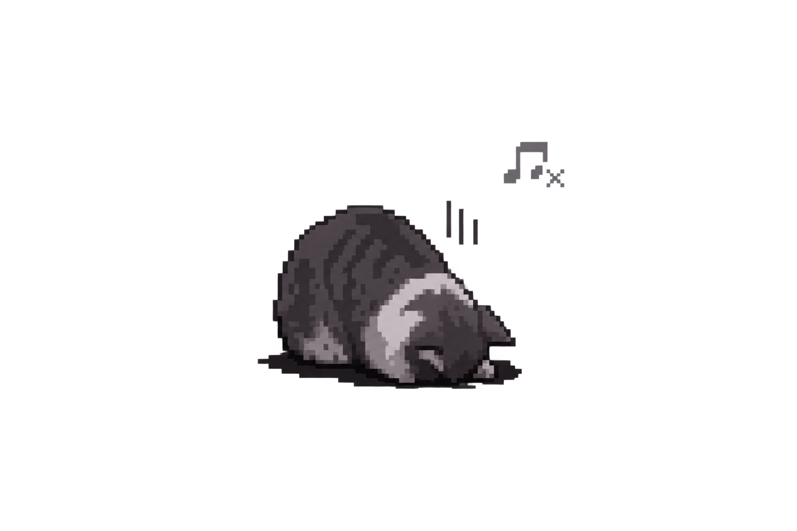

<p align="center">
  
</p>

<p align="center">
  <b>YouTube Music, a cava visualizer, and btop's sense of style, in one terminal window.</b><br>
  Written in Rust. Built for people who would rather <code>alt-tab</code> to a terminal than to a browser tab.
</p>

---

## So what is this

You like your music. You like your terminal. You like watching bars jump.
Until now that meant three programs: a browser tab with YouTube Music in it,
`cava` in one pane, and some regret.

**pova** is all of that in one place. It looks like btop: rounded boxes, little
superscript hotkeys in the borders, tabs you switch with a single key. It
plays YouTube Music: search, albums, artists, playlists, radio, your library
and likes. And it has a real cava-style visualizer, which listens to *pova's
own audio* and nothing else. Your Discord notification sounds are not music,
and pova knows that.

```
╭─┐¹visualizer┌─────────────────────┐v bars┌─╮╭─²┐now playing┌┐queue┌┐lyrics┌┐search┌┐library┌─╮
│                    ▄▄                     ││          ┌─────────────────┐                  │
│                 ▁▁ ██ ██                  ││          │   album art,    │                  │
│              ▆▆ ██ ██ ██ ▃▃               ││          │  real pixels in │                  │
│           ▅▅ ██ ██ ██ ██ ██ ▃▃            ││          │      kitty      │                  │
│ ▇▇ ▅▅  ▁▁ ██ ██ ██ ██ ██ ██ ██ ▁▁ ▂▂ ██    ││          └─────────────────┘                  │
│ ██ ██ ▇▇ ██ ██ ██ ██ ██ ██ ██ ██ ██ ██ ██  ││      Get Lucky (feat. Pharrell Williams) ♥    │
│ ██ ██ ██ ██ ██ ██ ██ ██ ██ ██ ██ ██ ██ ██  ││   ━━━━━━━━━━━━●────────────────────────────   │
│ ██ ██ ██ ██ ██ ██ ██ ██ ██ ██ ██ ██ ██ ██  │╰───────────────────────────────┐● signed in┌─╯
│ ██ ██ ██ ██ ██ ██ ██ ██ ██ ██ ██ ██ ██ ██  │╭─┐³controls┌───────────────────────────────╮
│ ██ ██ ██ ██ ██ ██ ██ ██ ██ ██ ██ ██ ██ ██  ││       ⇄     ⏮     ⏸     ⏭     ↻          │
╰─┐● live┌───────────────────────────────────╯╰────────────────────────────────────────╯
```

## What it does

- **Plays YouTube Music.** Search songs, videos, albums, artists and
  playlists. Open an album and play it from any track. Start a radio from any
  song. When the queue runs dry, autoplay keeps going with a radio of similar
  songs, the way the website does.
- **Starts songs fast.** pova looks up the audio for the songs you're about
  to play (the next two in the queue, the top search hit, whatever you rest the
  cursor on) before you press anything. Those start in about a third of a
  second. Without that, it takes about four.
- **Plays gaplessly.** The next track is preloaded, so albums meant to flow
  into each other actually do.
- **Is forgiving about spelling.** Type `call me when your sober`
  and you still get Evanescence, because pova takes YouTube Music's own
  "did you mean" and searches again. Suggestions drop down as you type.
- **Has a visualizer that's actually cava.** It's a line-by-line Rust port of
  cava's `cavacore`: same FFT, same bar spacing, same gravity and smoothing.
  Four modes: stereo bars, mirror, mono, and a Braille waveform.
- **Shows lyrics that keep up.** Time-synced lyrics from LRCLIB scroll and
  highlight as the song plays. If LRCLIB has nothing, pova asks YouTube Music.
  If *nobody* has lyrics, you get the cat. (See below. Be nice to the cat.)
- **Draws real album art.** Actual pixels in kitty through its graphics
  protocol. Other terminals get a halfblock version that still looks good.
- **Knows your account.** With a sign-in cookie you get your playlists,
  liked songs and history, and a ♥ on everything you've already liked. `f`
  toggles the like, and it won't like a song twice.
- **Uses btop themes. All of them.** pova reads btop's `.theme` files as they
  are, so if you have btop installed you already have about forty themes.
  Press `t` to preview them live.
- **Leaves nothing behind.** Quit with `Q`, close the window, even
  `kill -9`: mpv and the audio capture always go down with pova.

## Install

pova runs on Linux with PipeWire (it was built on Fedora KDE with kitty). You
need a few programs that do the heavy lifting:

```sh
# Fedora
sudo dnf install mpv yt-dlp pipewire-utils nodejs
sudo dnf install btop        # optional: ~40 themes for free
sudo dnf install mpv-mpris   # optional: media keys and the Plasma media widget
```

| Program | What pova uses it for |
|---|---|
| `mpv` | playing the audio (headless, no window) |
| `yt-dlp` | turning a YouTube Music link into an audio stream |
| `nodejs` or `deno` | lets yt-dlp solve YouTube's JavaScript challenge |
| `pw-record`, `pw-dump` (pipewire-utils) | capturing pova's audio for the visualizer |

Then build it (you need a Rust toolchain from <https://rustup.rs>):

```sh
git clone https://github.com/P0r0ro/pova
cd pova
cargo install --path .
pova
```

Or skip the search box entirely:

```sh
pova --play "daft punk around the world"
```

## Signing in

Search, playback, radio and lyrics all work without an account. Sign in to
get your library, liked songs, history, and the ♥ next to songs you've liked.

pova signs in the same way your browser does: with your YouTube Music
cookies. There's no OAuth app and no password prompt. You just let pova borrow
the cookie your browser already has.

### The easy way

If you're signed in to <https://music.youtube.com> in your browser:

```sh
./scripts/import-cookie.sh chrome     # or firefox, chromium, brave, edge, vivaldi, opera
```

It asks yt-dlp to read your browser's cookie store (on KDE, Chrome's cookies
are unlocked through KWallet), keeps only the youtube.com cookies, and writes
them as a single line to `~/.config/pova/cookie.txt` with permissions `600`.
It never prints the cookie values. To use a specific browser profile, write
`chrome:Profile 2`.

### The manual way

1. Open <https://music.youtube.com> in your browser while signed in.
2. Open DevTools, go to **Network**, and click any request to `music.youtube.com`.
3. Copy the full value of the **Cookie** request header.
4. Paste it on one line into `~/.config/pova/cookie.txt`, then run
   `chmod 600 ~/.config/pova/cookie.txt`.

Restart pova. The bottom of the player box says **● signed in**.

**Treat `cookie.txt` like a password.** It grants access to your Google
account. It stays on your machine and pova only sends it to YouTube Music. If
pova ever goes back to "○ signed out", Google has rotated the cookie, so run
the script again.

## Keys

pova uses btop's idea of keys: one keystroke per thing, with the important
letters highlighted in the borders. Press `?` inside pova for the full list,
including any keys you've remapped.

| Key | Does | Key | Does |
|---|---|---|---|
| `space` | play / pause | `n` `q` `l` `/` `b` | now playing, queue, lyrics, search, library |
| `←` `→` | seek 5 s | `tab` / `shift+tab` | next / previous tab |
| `H` `L` | seek 30 s | `1` `2` `3` | show / hide the three boxes |
| `<` `>` or `P` `N` | previous / next track | `j` `k` `↑` `↓` `g` `G` | move around lists |
| `+` `-` `m` | volume, mute | `enter` | play or open the selection |
| `S` `R` | shuffle, repeat (off / all / one) | `a` / `A` | add to queue / play next |
| `f` | like or unlike the current song | `r` | start a radio from the selection |
| `v` | change visualizer mode | `d`, `J` `K`, `C` | queue: remove, move, clear |
| `t` | theme picker (live preview) | `[` `]` | change search filter / library section |
| `esc` | back, or the menu | `c` | jump to the playing track |
| `Q` | quit | `F5` | reload the current list |

**In the search box:** type, and suggestions appear underneath. `↑` `↓` pick
one, `→` accepts the dimmed completion, `tab` changes the filter (Songs,
Videos, Albums, Artists, Playlists), `enter` searches.

**The Esc menu.** Like btop, pressing `esc` when there's nothing to go back
from opens a menu with the pova logo drawn in block characters, in the logo's
own violet-to-pink gradient. From it you pick a theme, change the visualizer
mode, and turn autoplay and album art on and off. Your choices are saved.

The mouse works too: click tabs, buttons, list rows and the progress bar, and
scroll through lists.

## Meet the cat

<p align="center">
  
</p>

This is pova's mascot. It lives in the Lyrics tab and appears only when a
song has no lyrics anywhere: not on LRCLIB, not on YouTube Music, nowhere. It's
not angry. It's just disappointed. Mostly it shows up for instrumentals,
obscure uploads and "Me at the zoo".

## Configuration

`~/.config/pova/config.toml` is created on first run with every option in it:

```toml
theme = "Default"          # any btop theme name: "dracula", "gruvbox_dark", "tokyo-night"...
theme_background = true    # false keeps your terminal's own (maybe transparent) background
rounded_corners = true
volume = 70
autoplay = true            # keep playing similar songs when the queue ends
album_art = true
image_protocol = "auto"    # auto | kitty | sixel | iterm2 | halfblocks
mpv_args = []              # extra flags for mpv, if you want them

[viz]
mode = "bars"              # bars | mirror | mono | wave
source = "mpv"             # "mpv" = only pova's audio; "system" = everything, like plain cava
bar_width = 2
bar_spacing = 1
noise_reduction = 0.77     # cava's smoothing: higher is calmer
framerate = 60
low_cut_off = 50
high_cut_off = 10000
sample_rate = 44100

[keys]                     # remap anything; press ? in pova for action names
next = ["N", "ctrl+right"]
```

pova remembers your last theme, volume, visualizer mode, box layout and menu
settings in `~/.local/state/pova/state.toml`.

**Themes** are looked up in `~/.config/pova/themes/`, `~/.config/btop/themes/`
and `/usr/share/btop/themes/`. Run `pova --list-themes` to see what you have.
To make your own, copy a btop theme and change it. These are the keys pova
reads:

| btop key | used by pova for |
|---|---|
| `main_bg`, `main_fg`, `title`, `hi_fg`, `selected_bg/fg`, `inactive_fg`, `div_line` | the same things as in btop |
| `cpu_box`, `proc_box`, `mem_box` | the visualizer, player and controls borders |
| `cpu_start`, `cpu_mid`, `cpu_end` | the visualizer's colour gradient |
| `download_start/mid/end` | the progress and volume bars |

pova also understands a few keys btop doesn't have: `viz_start/mid/end` and
`progress_start/mid/end`.

## How it works

The short version: pova is the conductor, and a few specialists do the actual
work.

```
 keys, mouse ──► App ◄──────────────── events ──────────────────┐
                 │  one central state, redrawn up to 60 fps     │
                 ├──► player ──► mpv (JSON IPC socket) ─────────┤
                 ├──► ytm ─────► YouTube Music (ytmapi-rs) ─────┤
                 ├──► resolver ► yt-dlp, ahead of time ─────────┤
                 ├──► lyrics ──► LRCLIB ────────────────────────┤
                 └──► art ─────► thumbnails, disk cache ────────┘

 mpv's PipeWire stream ─► pw-record ─► capture thread
        ─(lock-free ring buffer)─► DSP thread (cavacore port) ─► bars on screen
```

Each specialist runs on its own and only talks through messages. A slow lyrics
server can't freeze the visualizer, and a YouTube hiccup can't stop the music.

**Playback.** pova starts mpv with no window and steers it over mpv's JSON
socket: load, pause, seek, volume. pova owns the queue. mpv only ever knows
about two songs, the one playing and the one coming next. Preloading the next
one is what makes playback gapless. Shuffle can be undone, too: every queue
entry remembers when it was added, so turning shuffle off restores your order.

**The four-second problem.** Before mpv can play a YouTube Music song, yt-dlp
has to work out the real audio address, which involves solving a JavaScript
puzzle YouTube sets. That takes three to four seconds every time. pova's
resolver does it in the background for the songs you're probably about to
play. It runs at most two lookups at a time so YouTube stays happy, and it
keeps the answers until shortly before they expire (about six hours). If a
saved address stops working, pova quietly falls back to the slow way, so
nothing ever fails because of the shortcut.

**YouTube Music.** There's no official API, so pova uses
[ytmapi-rs](https://github.com/nick42d/youtui), which talks to the same
private API the website uses. For misspelled searches, YouTube answers with
"Did you mean", which the library reads as zero results, so pova pulls the
corrected query out of the raw response and searches again.

**The visualizer.** mpv plays through PipeWire under a name unique to each
pova window (`pova-<pid>`). pova finds that stream in the PipeWire graph and
records it with `pw-record`, so you see pova's music and nothing else. Run two
pova windows and each one shows its own song. Samples go through a lock-free
ring buffer to a DSP thread running the cavacore port: a long FFT for bass and
a short one for treble, log-spaced bars, gravity, and automatic sensitivity.
While paused or silent the DSP thread idles, so pova sits at about 2% CPU.

**Lyrics.** On every new song pova asks LRCLIB for time-synced lyrics, first
by exact title, artist and length, then with a looser search. Titles get
cleaned up first: "(Official Video)", "[HD]" and friends are removed. If LRCLIB
has nothing, YouTube Music's plain lyrics are next. If that's empty too, the
cat comes out.

**Album art in kitty.** Images use kitty's graphics protocol with Unicode
placeholders, so each image is sent to the terminal only once, not on every
frame. One catch: an image row only knows its position from its first cell.
When a popup covers the start of a row, kitty forgets where the rest of it
goes. pova fixes the cells next to the popup so the art stays intact around
menus. For video thumbnails, black letterbox bars are trimmed before
cropping to a square.

**Like status.** When you sign in, pova loads your liked songs in the
background, and any list that comes with like information (albums, playlists,
history) adds to it. That's how ♥ shows up even on plain search results, and
how `f` knows to unlike rather than like again.

**Logs** go to `~/.cache/pova/pova.log` and never onto your screen. Use
`pova --log-level debug` to see things like "track started in 343 ms
(pre-resolved URL)".

## Known limits

- pova reads only your first ~400 liked songs. Past that, the YouTube Music
  library pova uses can't parse a page of large libraries, so pova keeps what
  it got rather than showing nothing.
- It all depends on YouTube Music's private API and on yt-dlp keeping up with
  YouTube. When YouTube changes something, update yt-dlp first (`yt-dlp -U` or
  your package manager).
- Linux with PipeWire only, for now. The visualizer needs `pw-record`.

## Building and hacking

```sh
./scripts/check.sh                      # rustfmt check, clippy (warnings are errors), all tests
cargo test -- --ignored live_api        # also hits the real YouTube Music API
```

The tests cover the cavacore port with real test tones, every btop theme on
your machine, the queue, the search box, likes, the fast-start resolver, kitty
image output, and rendering at five terminal sizes.
[MILESTONES.md](MILESTONES.md) shows how the project came together.

## Credits

pova stands on the shoulders of:
[mpv](https://mpv.io),
[yt-dlp](https://github.com/yt-dlp/yt-dlp),
[cava](https://github.com/karlstav/cava) by Karl Stavestrand, whose
`cavacore` the visualizer is ported from (MIT),
[btop](https://github.com/aristocratos/btop) for the look and the themes,
[ytmapi-rs](https://github.com/nick42d/youtui) for YouTube Music,
[LRCLIB](https://lrclib.net) for lyrics,
[ratatui](https://ratatui.rs) and
[ratatui-image](https://github.com/benjajaja/ratatui-image) for drawing
everything.

## License

MIT. See [LICENSE](LICENSE), which also includes the notices for the parts
ported from cava and ratatui-image.
