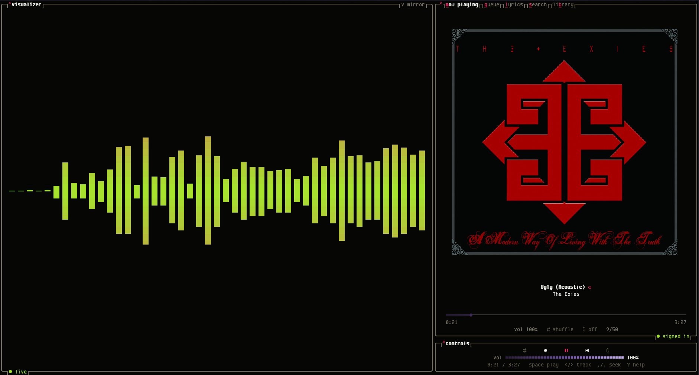
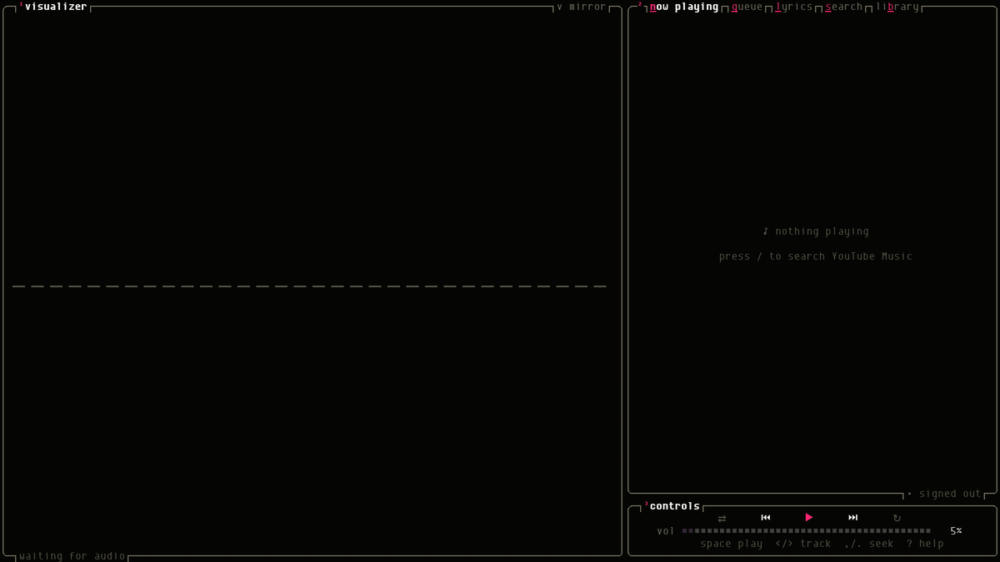
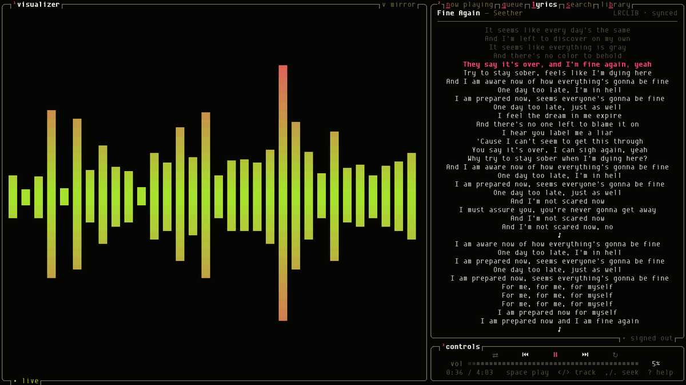
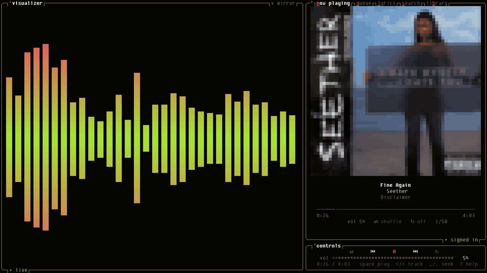

<p align="center">
  
</p>

<p align="center">
  <b>YouTube Music, a cava visualizer, and btop's sense of style, in one terminal window.</b><br>
  Written in Rust. Built for people who would rather <code>alt-tab</code> to a terminal than to a browser tab.
</p>

---

## So what is this

You like your music. You like your terminal. You like watching bars jump.
Until now that meant three programs: a browser tab with YouTube Music in it,
`cava` in one pane, and some regret.

**pova** is all of that in one place. It looks like btop, it plays YouTube
Music, and its visualizer is a real port of cava that listens to *pova's own
audio* and nothing else. Your Discord notification sounds are not music, and
pova knows that.

<p align="center">
  <a href="assets/pova-launch.mp4">
    
  </a><br>
  <sub><a href="assets/pova-launch.mp4">Watch it with sound (MP4)</a> · music: Sascha Ende, ende.app (CC BY 4.0)</sub>
</p>

<p align="center">
  
</p>

## Install

pova runs on Linux with PipeWire. It was built on Fedora KDE with kitty, and
kitty shows real album art (other terminals get a blocky version).

**The easy way: a package.** It installs pova together with everything it
needs (mpv, yt-dlp, PipeWire tools) from your distro's own repositories, and
adds pova to your app menu. Grab it from the
[latest release](https://github.com/P0r0ro/pova/releases/latest):

```sh
sudo dnf install ./pova-1.0.1-1.x86_64.rpm     # Fedora
sudo apt install ./pova_1.0.1-1_amd64.deb      # Debian, Ubuntu
```

Otherwise, install the helpers yourself and pick an AppImage, a prebuilt
binary, or build from source:

**1. The helpers pova drives:**

```sh
# Fedora
sudo dnf install mpv yt-dlp pipewire-utils nodejs
sudo dnf install btop        # optional: ~40 themes for free
sudo dnf install mpv-mpris   # optional: media keys and the Plasma media widget
```

**2. pova itself.** Grab the prebuilt binary from the
[latest release](https://github.com/P0r0ro/pova/releases/latest), or build it.

```sh
# AppImage (x86_64 Linux): download, make executable, run it from a terminal
chmod +x pova-v1.0.1-x86_64.AppImage
./pova-v1.0.1-x86_64.AppImage

# prebuilt binary (x86_64 Linux)
tar xzf pova-v1.0.1-x86_64-linux.tar.gz
install -Dm755 pova-v1.0.1-x86_64-linux/pova ~/.local/bin/pova

# or from source (needs a Rust toolchain from https://rustup.rs)
git clone https://github.com/P0r0ro/pova
cd pova
cargo install --path .
```

**3. Play something:**

```sh
pova                                   # then press / and search
pova --play "seether fine again"       # or straight from the shell
```

## What you can do

### Search from your terminal

Press `/`, start typing, and suggestions drop down under the box. Spelling
is optional: type `call me when your sober` and pova still finds Evanescence,
the same way YouTube Music's own "did you mean" would. `tab` switches between
Songs, Videos, Albums, Artists and Playlists; `enter` plays.

<p align="center"></p>

### Queue things up

`A` plays the selected song next, `a` adds it to the end. In the queue (`q`),
`J` and `K` move songs up and down, `d` removes them. When the queue runs out,
autoplay keeps going with a radio of similar songs, like the website does.

<p align="center"></p>

### Move between songs

`N` and `P` skip forward and back, `←` `→` seek 5 seconds, `H` `L` seek 30.
pova looks up the next songs while the current one plays, so skipping is
near-instant, and the next track is preloaded so albums play gaplessly.

<p align="center"></p>

### Live lyrics

Press `l`. Time-synced lyrics from LRCLIB scroll and highlight as the song
plays. If LRCLIB has nothing, pova asks YouTube Music. If *nobody* has
lyrics, you get the cat. (See below. Be nice to the cat.)

<p align="center"></p>

### Like songs

Press `f` to like or unlike what's playing. Songs you've already liked show a
♥ everywhere: in Now Playing, the queue and search results. This needs you
to sign in once (next section).

<p align="center"></p>

### And also

- **Four visualizer modes** (`v`): stereo bars, mirror, mono and a waveform.
- **Every btop theme** (`t`): pova reads btop's `.theme` files as they are, with a live preview.
- **The Esc menu**: btop-style, with the pova logo drawn in block characters, for themes, the visualizer, autoplay and album art.
- **Your library** (`b`): your playlists, liked songs and history once you're signed in.
- **Mouse support**: click tabs, buttons, list rows and the progress bar.

Press `?` in pova for every key, or read [docs/keys.md](docs/keys.md).

## Signing in

Search, playback, radio and lyrics work without an account. To like songs and
see your library, let pova borrow the YouTube Music login your browser already
has. If you're signed in to <https://music.youtube.com>:

```sh
pova-import-cookie chrome              # installed with the .deb / .rpm
./scripts/import-cookie.sh chrome      # from a source checkout
# works with firefox, chromium, brave, edge, vivaldi, opera too
```

Restart pova and the player box says **● signed in**. The cookie is saved in
`~/.config/pova/cookie.txt`, readable only by you. Treat it like a password.
No script? [docs/signing-in.md](docs/signing-in.md) has the manual way.

## Meet the cat

<p align="center">
  
</p>

This is pova's mascot. It lives in the Lyrics tab and appears only when a
song has no lyrics anywhere: not on LRCLIB, not on YouTube Music, nowhere. It's
not angry. It's just disappointed. Mostly it shows up for instrumentals,
obscure uploads and "Me at the zoo".

## More

- [docs/keys.md](docs/keys.md): every key
- [docs/configuration.md](docs/configuration.md): the config file, themes, remapping keys
- [docs/signing-in.md](docs/signing-in.md): signing in, step by step
- [docs/how-it-works.md](docs/how-it-works.md): how pova works inside, and its known limits
- [docs/development.md](docs/development.md): building, tests, contributing

## Credits

pova stands on the shoulders of
[mpv](https://mpv.io),
[yt-dlp](https://github.com/yt-dlp/yt-dlp),
[cava](https://github.com/karlstav/cava) (its visualizer is ported from cava's `cavacore`),
[btop](https://github.com/aristocratos/btop) for the look and the themes,
[ytmapi-rs](https://github.com/nick42d/youtui),
[LRCLIB](https://lrclib.net),
[ratatui](https://ratatui.rs) and
[ratatui-image](https://github.com/benjajaja/ratatui-image).

## License

MIT, see [LICENSE](LICENSE). The parts ported from cava and ratatui-image keep
their own MIT notices in [THIRD_PARTY_NOTICES.md](THIRD_PARTY_NOTICES.md).
