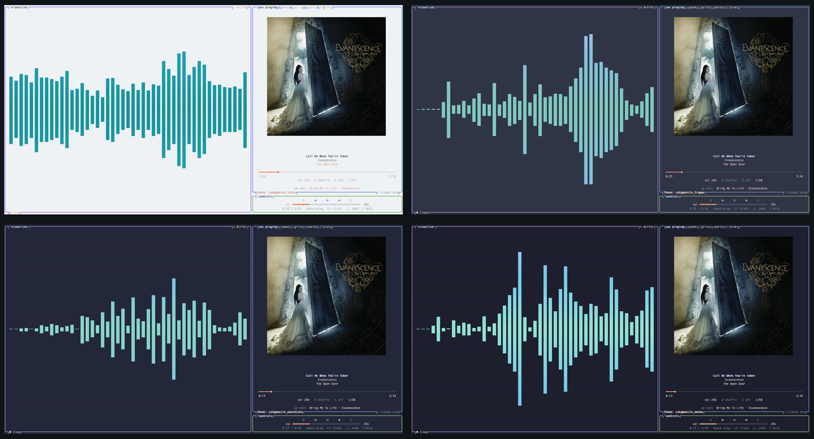

# Configuration and themes

`~/.config/pova/config.toml` is created on first run with every option in it:

```toml
theme = "Default"          # any btop theme name: "dracula", "gruvbox_dark", "tokyo-night"...
theme_background = true    # false keeps your terminal's own (maybe transparent) background
rounded_corners = true
volume = 70
autoplay = true            # keep playing similar songs when the queue ends
album_art = true
image_protocol = "auto"    # auto | kitty | sixel | iterm2 | halfblocks
mpv_args = []              # extra flags for mpv, if you want them
resume = true              # start where you left off: same queue, same spot, paused
normalize_loudness = true  # play every song at the same loudness
notifications = false      # desktop popup with the cover art when the song changes
media_controls = true      # desktop media widget, media keys, lock screen, playerctl
crossfade = "off"          # off | smooth | overlap: how one song turns into the next

[viz]
mode = "bars"              # bars | mirror | mono | wave
source = "mpv"             # "mpv" = only pova's audio; "system" = everything, like plain cava
bar_width = 2
bar_spacing = 1
noise_reduction = 0.77     # cava's smoothing: higher is calmer
framerate = 60
low_cut_off = 50
high_cut_off = 10000
sample_rate = 44100

[keys]                     # remap anything; press ? in pova for action names
next = ["N", "ctrl+right"]
```

pova remembers your last theme, volume, visualizer mode, box layout and menu
settings in `~/.local/state/pova/state.toml`.

**Even loudness, notifications, media controls and crossfade** can also be switched in pova's `esc`
menu. What you pick there wins over `config.toml`.

- `normalize_loudness` runs mpv's loudness filter (EBU R128, aiming at the
  -14 LUFS YouTube itself uses), so a quiet acoustic song and a loud master
  play at about the same volume. If you set your own audio filter with
  `--af=` in `mpv_args`, that replaces pova's.
- `notifications` needs `notify-send` (the `libnotify` package; `libnotify-bin`
  on Debian and Ubuntu). Each new song replaces the previous popup, so they
  don't pile up.
- `media_controls` lets your desktop control pova: the media widget in the
  panel or top bar, media keys, the lock screen, KDE Connect, waybar and
  `playerctl`. It works on every Linux desktop (it's the MPRIS standard), runs
  inside pova (no extra program) and only shows information while it's on.
  See [remote-control.md](remote-control.md#media-keys-and-desktop-widgets).
- `crossfade` changes how songs follow each other when one ends by itself
  (skipping with `>` is always immediate):
  - `off`: straight on, gapless, like before.
  - `smooth`: the end of each song fades out over its last four seconds and
    the next fades in. Free: it's a gain setting inside pova's mpv (needs mpv
    0.38 or newer; older mpv simply plays without the fade).
  - `overlap`: a real crossfade. For the last six seconds the old song fades
    out while the next one is already fading in. To play both at once, pova
    starts a second mpv for those few seconds, which uses about 60 to 100 MB
    more memory while it runs, then quits. When a song's stream address isn't
    ready in time, or you seek or pause near the end, that change uses
    `smooth` instead.

**Themes** are looked up in `~/.config/pova/themes/`, `~/.config/btop/themes/`
and `/usr/share/btop/themes/`. Run `pova --list-themes` to see what you have.

Built in, with nothing to install: btop's Default and the four
[Catppuccin](https://catppuccin.com) flavours, `catppuccin_latte`,
`catppuccin_frappe`, `catppuccin_macchiato` and `catppuccin_mocha` (from
[catppuccin/btop](https://github.com/catppuccin/btop)). A theme file with the
same name in one of the folders above replaces the built-in copy.

<p align="center"></p>
To make your own, copy a btop theme and change it. These are the keys pova
reads:

| btop key | used by pova for |
|---|---|
| `main_bg`, `main_fg`, `title`, `hi_fg`, `selected_bg/fg`, `inactive_fg`, `div_line` | the same things as in btop |
| `cpu_box`, `proc_box`, `mem_box` | the visualizer, player and controls borders |
| `cpu_start`, `cpu_mid`, `cpu_end` | the visualizer's colour gradient |
| `download_start/mid/end` | the progress and volume bars |

pova also understands a few keys btop doesn't have, and ignores the rest:

| pova key | used for | default |
|---|---|---|
| `viz_start/mid/end` | the visualizer gradient, instead of `cpu_*` | `cpu_*` |
| `progress_start/mid/end` | the progress and volume bars, instead of `download_*` | `download_*` |
| `logo_start/mid/end` | the logo and highlight in the Esc menu | pova's violet to pink |
| `logo_text` | the logo's letters | near white |
| `error` | the error box and "Yes, delete" button | red |

btop ignores these keys, so one theme file works in both. Text on the Esc
menu highlight and the delete button turns black or white by itself,
whichever reads better.

The full list of action names for `[keys]` is in [keys.md](keys.md).

Back to the [README](../README.md).
